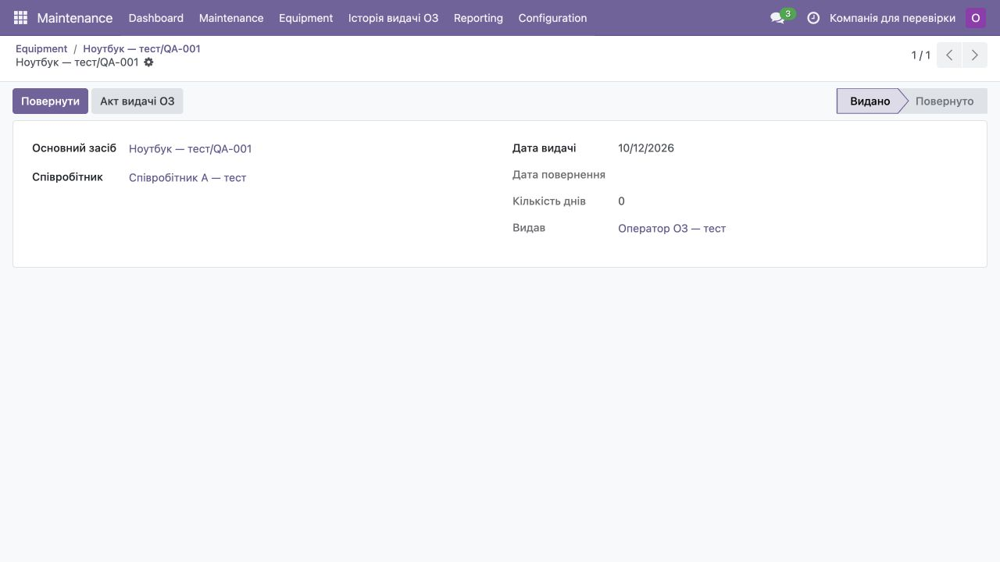
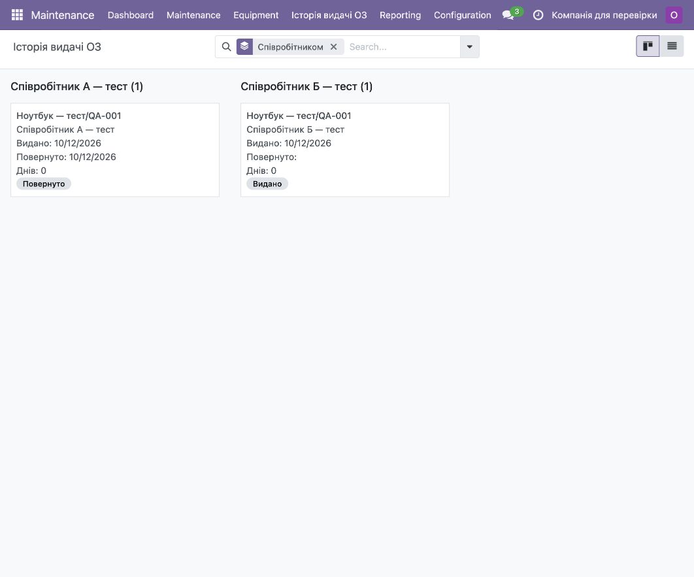

# Видача обладнання співробітникам

Модуль для Odoo 18 Community, який дозволяє видавати основні засоби співробітникам, повертати їх та переглядати історію використання.

Обладнання зберігається у стандартній моделі `maintenance.equipment`, співробітники у `hr.employee`. Зв'язок між ними надає стандартний модуль `hr_maintenance`.

## Що реалізовано

- Видача обладнання співробітнику через кнопку **Видано**.
- Повернення через кнопку **Повернути**. Після повернення обладнання доступне для наступної видачі.
- Збереження співробітника та дати видачі у стандартних полях картки обладнання.
- Історія з датами видачі й повернення та користувачами, які виконали ці дії.
- Обчислення кількості днів використання.
- Канбан історії з групуванням за обладнанням або співробітником, а також перегляд списком.
- PDF-звіт **Акт видачі ОЗ** для конкретного співробітника та обладнання.
- Заборона двох активних видач одного обладнання, зокрема при одночасних запитах.

## Як це працює

У картці обладнання натисніть **Видано**, оберіть співробітника та дату. Модуль створить запис історії та запише поточного співробітника в картку обладнання. З цього запису можна надрукувати акт.

Кнопка **Повернути** заповнює дату повернення в історії й очищує поточного співробітника в картці. Попередній запис залишається, а наступна видача створює новий запис.

### Запис видачі

Відображає обладнання, співробітника, дату, кількість днів та користувача, який виконав видачу. Тут доступні повернення й друк акта.



### Історія за співробітниками

Канбан показує активні та завершені видачі. Групування можна переключити на основний засіб.



[Приклад акта видачі ОЗ](docs/sample-issue-act.pdf). На скриншотах і в акті використані навчальні дані.

## Що додано до стандартних модулів

Стандартні картки обладнання та співробітника, модель, серійний номер, поле призначеного співробітника й дата призначення використані з Maintenance та HR.

У власному модулі `equipment_assignment` додано:

- Модель `equipment.assignment` для окремого запису кожної видачі та повернення.
- Тимчасову форму `equipment.issue.wizard` для вибору співробітника й дати видачі.
- Кнопки видачі, повернення та переходу до історії у стандартній формі обладнання.
- Вкладку історії й поля кількості видач та днів використання.
- Форми, список, канбан, пошук і меню історії з двома варіантами групування.
- Шаблон QWeb та стандартну дію друку PDF-акта.
- Права доступу для HR Officer і правило доступу за компаніями.
- Перевірки дат, компаній та змін історії. Блокування рядка обладнання і SQL-обмеження захищають від одночасної подвійної видачі.

Стандартні модулі розширюються через успадкування моделей та XML-форм.

## Запуск у Docker

Потрібні Docker із Compose v2 та Python 3. Команди виконуються з цієї папки:

```bash
cp .env.example .env
```

Вкажіть у `.env` власні значення `DB_PASSWORD`, `MASTER_PASSWORD` та `ADMIN_PASSWORD`. Порт задається через `ODOO_PORT`, назва бази через `DB_NAME`.

```bash
python3 scripts/run.py start
```

Docker Compose читає змінні з `.env` та передає їх контейнерам. Скрипт `scripts/container.py` підставляє їх у шаблон `config/odoo.conf` і запускає Odoo з отриманим конфігом. Файл `.env` не додається до Git.

Дочекайтеся завершення встановлення модуля:

```bash
docker compose logs -f web
```

За стандартного порту відкрийте [Odoo](http://127.0.0.1:38069). Логін `admin`, пароль зі змінної `ADMIN_PASSWORD`. На першому запуску створюється порожня база; співробітників та обладнання потрібно додати через інтерфейс.

```bash
python3 scripts/run.py stop
```

Зупинка зберігає базу та файли у Docker volumes. Для наступного запуску використовуйте той самий пароль PostgreSQL. Пароль `admin` задається з `.env` під час кожного старту цього локального середовища.

## Встановлення у власне середовище Odoo

1. Додайте папку `addons` до `addons_path` вашого конфіга Odoo.
2. Оновіть список застосунків та встановіть **Видача обладнання співробітникам** (`equipment_assignment`). Якщо увімкнений фільтр Apps, приберіть його: це розширення Maintenance.
3. Надайте користувачу роль **Employees / Officer** (`hr.group_hr_user`). Через стандартний `hr_maintenance` вона також надає права керування обладнанням.

CLI для підготовленої бази та вашого конфіга:

```bash
odoo-bin -c odoo.conf -d your_database -i equipment_assignment --stop-after-init
```

## Сценарій перевірки

1. У **Employees** створіть двох співробітників однієї компанії.
2. У розділі **Equipment** застосунку **Maintenance** створіть ноутбук. Заповніть компанію, модель та серійний номер; у **Used By** залиште **Employee**.
3. Натисніть **Видано**, виберіть співробітника і дату, підтвердьте. Відкриється запис історії. У картці обладнання з'являться співробітник та дата видачі.
4. Надрукуйте **Акт видачі ОЗ** із запису історії або через меню друку.
5. Спробуйте повторну видачу того самого обладнання: сервер відмовить. У картці кнопка видачі прихована, поки обладнання зайняте.
6. Натисніть **Повернути**. Поточний співробітник очиститься, запис історії залишиться з датою повернення.
7. Видайте обладнання другому співробітнику: історія міститиме два окремі записи.
8. У застосунку **Maintenance** відкрийте **Історія видачі ОЗ**. У меню **Групувати за** виберіть **Основним засобом** або **Співробітником**. Для зміни групування приберіть попередній фільтр.

## Прийняті правила

- Один запис обладнання означає одну фізичну одиницю. Стандартне поле `model` описує її модель, `serial_no` містить серійний номер.
- Повернення «на склад» означає, що обладнання вільне для наступної видачі. Документи Inventory та бухгалтерська амортизація не входять у цей модуль.
- Дні обчислюються як різниця календарних дат: у день видачі `0`. Для активної видачі кінцева дата сьогодні, для завершеної це дата повернення. Поле не збережене в БД, тому оновлюється при читанні без cron.
- Можна вказати минулу дату видачі, але не майбутню та не ранішу за останнє повернення. Повторна видача в день повернення дозволена. Кнопка повернення використовує сьогоднішню дату.
- Видачі можливі тільки між обладнанням і активним співробітником однієї компанії. Обладнання повинно мати компанію.
- Історію не редагують і не видаляють. Зміна поточного співробітника виконується тільки через видачу та повернення. Перед архівацією виданого обладнання або зміною його призначення потрібне повернення.
- Розширення розраховане на нові видачі. Міграція попередніх призначень у наявній базі не реалізована.
- Акт містить дані карток на момент друку. Окремий незмінний архів підписаних документів не реалізовано.
